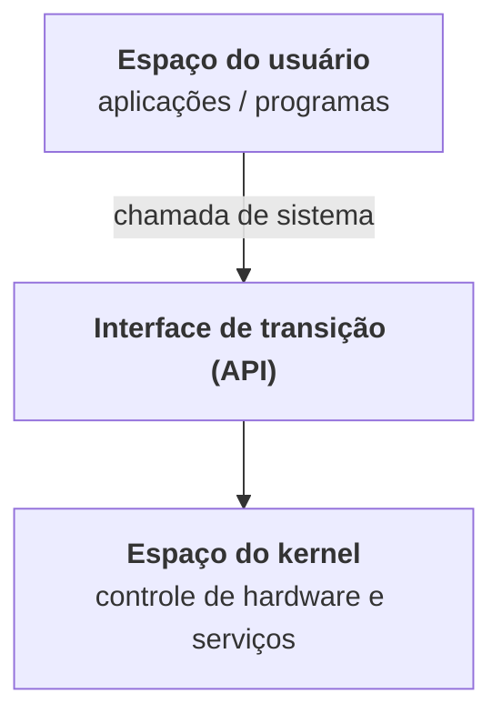

# Unidade 2 · Estruturas do Sistema Operacional

<div class="resumo-aula" markdown>
[:material-presentation-play: Abrir os slides](../arquivos/unidade-2.pdf){ .md-button .md-button--primary target="_blank" }
[:material-download: Baixar PDF · 108 slides](../arquivos/unidade-2.pdf){ .md-button download }
[:material-arrow-right: Próxima: Processos](unidade-3.md){ .md-button }
</div>

!!! abstract "Nesta unidade"
    1. **Características e serviços dos S.Os** — Windows × Linux e funcionalidades de um S.O.
    2. **Chamadas de sistema** — a ponte entre o espaço do usuário e o kernel.
    3. **Projeto e implementação** — objetivos, mecanismos × políticas e linguagens usadas.
    4. **Estrutura do S.O** — monolítico, camadas, microkernel, módulos e híbridos.
    5. **Depuração** — análise de falhas e ajuste de desempenho.
    6. **Inicialização** — o programa bootstrap.

## Slides

<div class="pdf-slides">
  <iframe src="../../arquivos/unidade-2.pdf#view=FitH" title="Slides da Unidade 2" loading="lazy"></iframe>
</div>

!!! tip "No celular os slides não aparecem?"
    Alguns navegadores de celular não exibem PDF dentro da página. Use o botão **Abrir os slides** acima.

## Resumo da unidade

### Parte I · Características e serviços dos S.Os

<span class="slides-ref">[Slides 3–30](../arquivos/unidade-2.pdf#page=3){ target="_blank" }</span>

**Windows × Linux**

| Aspecto | Linux | Windows |
|---|---|---|
| Origem e licença | Kernel desenvolvido pela comunidade sob supervisão de Linus Torvalds; licença **GPL** (modificar, reutilizar e vender) | Desenvolvido pela Microsoft sobre o kernel NT; proprietário, sem acesso ao código-fonte |
| Configurações | Arquivos de texto: globais em `/etc/`, do usuário em diretórios ocultos (`~/.config/`). Um arquivo danificado afeta só aquela função | **Registro** (*Registry*): base de dados hierárquica e centralizada; uma corrupção pode impedir a inicialização |
| Sistema de arquivos | Raiz única `/`; unidades são montadas em pastas | Unidades recebem letras |
| Instalação de programas | **Repositórios** e gerenciador de pacotes, que resolve as dependências | Busca manual de instaladores, com risco de softwares indesejados |
| Controle de acesso | Login como usuário comum; `root` e `sudo` só quando necessário | Usuários costumam logar como administradores, o que facilita infecções |
| Personalização | Muitas distribuições (Ubuntu, Fedora, Debian, Kali...) | Poucas opções nativas |
| Atualizações | Controladas pelo usuário, geralmente sem reiniciar | Podem ocorrer a qualquer momento, geralmente obrigatórias |
| Suporte | Grande comunidade de fóruns | Suporte acessível, fóruns e suporte pago |

**Funcionalidades de um S.O**

1. **Interface usuário-hardware:** interface gráfica (GUI) ou linha de comando (CLI).
2. **Coordenar componentes de hardware**, usando *drivers* como "tradutores".
3. **Gerenciamento de dispositivos** e de seus drivers.
4. **Fornecer ambiente de software** para os aplicativos funcionarem.
5. **Gerenciamento de dados** em uma estrutura de diretórios.
6. **Monitoramento do sistema:** uso de CPU, discos, rede e ameaças.

### Parte II · Chamadas de sistema (*system calls*)

<span class="slides-ref">[Slides 31–50](../arquivos/unidade-2.pdf#page=31){ target="_blank" }</span>

Uma **chamada de sistema** é uma rotina que funciona como ponte: permite que um aplicativo do usuário peça ao **kernel**, de forma segura, ações que exigem privilégios especiais do hardware.



!!! example "Exemplo dos slides: `printf` em C"
    ```c
    #include <stdio.h>

    int main(void) {
        printf("Hello World!\n");
        return 0;
    }
    ```

    - `printf()` é uma **função de biblioteca**: internamente, ela faz a chamada de sistema `write()` para exibir a saída.
    - Uma função como `sqrt()` roda **totalmente no espaço do usuário**.
    - Para chamar o S.O, o programa executa uma instrução de interrupção (`syscall`, em Assembly), e o controle passa ao **modo kernel**, que executa a operação privilegiada.

**Categorias de chamadas de sistema vistas nos slides:**

| Categoria | Exemplos de operações |
|---|---|
| Gerenciamento de processos | Criar processo (`fork()`), esperar o término (`wait`), terminar, obter informações |
| Sinais | Interromper um processo, informar exceções do hardware, definir limites de tempo, suspender um processo (ex.: `sigaction`, `kill`, `pause`, `alarm`) |
| Gerenciamento de arquivos | Criar/abrir, fechar, ler/escrever, mover o ponteiro do arquivo |
| Gerenciamento de diretórios | Criar/remover diretórios, links, (des)montar sistemas de arquivos, mudar diretório atual ou root |
| Proteção | Modificar permissões, informações de usuário, mudar o dono de um arquivo |
| Gerência do tempo | Hora atual (segundos desde 1º/1/1970), modificar a hora, horários de acesso de arquivos, uso de CPU |

!!! info "Como funciona o `fork()`"
    Cria uma **cópia idêntica** do processo pai. Retorna **0** para o processo filho e o **PID do filho** para o pai. Com `wait`, o pai fica bloqueado até o filho terminar.

### Parte III · Projeto e implementação

<span class="slides-ref">[Slides 51–66](../arquivos/unidade-2.pdf#page=51){ target="_blank" }</span>

O primeiro problema ao projetar um S.O é definir **objetivos e especificações**, que dependem do hardware e do tipo de sistema (batch, tempo compartilhado, mono ou multiusuário, distribuído, tempo real, uso geral).

| Objetivos de usuário | Objetivos do sistema |
|---|---|
| Conveniente, fácil de aprender e usar, confiável, seguro e veloz | Fácil de projetar, implementar e manter; confiável, sem erros e eficiente |

Esses requisitos são vagos e **não há solução única** — o VxWorks (tempo real, embarcados) e o MVS (mainframe IBM) têm objetivos completamente diferentes.

!!! abstract "Mecanismos × políticas"
    - **Mecanismo:** *como* fazer algo.
    - **Política:** *o que* deve ser feito.

    Exemplo: o *timer* é um mecanismo que protege a CPU; por quanto tempo ele é ajustado para um usuário é uma decisão de política. Idealmente, o mecanismo é **insensível à política**: o mesmo mecanismo de prioridade pode favorecer programas I/O-intensivos ou CPU-intensivos.

**Implementação.** Kernels como Linux e Windows são escritos essencialmente em **C**, com pequenos trechos em Assembly. Linguagens de alto nível trazem desenvolvimento mais rápido, código mais claro e fácil de depurar, e **portabilidade** (o MS-DOS, em Assembly do Intel 8088, só rodava em x86; o Linux, em C, roda em muitos processadores). As desvantagens são menor velocidade e maior consumo de recursos.

### Estrutura do S.O

<span class="slides-ref">[Slides 67–86](../arquivos/unidade-2.pdf#page=67){ target="_blank" }</span>

| Estrutura | Como funciona | Vantagens | Desvantagens |
|---|---|---|---|
| **Sem estrutura / monolítica** | MS-DOS: aplicativos acessam rotinas básicas diretamente. UNIX: componentes do kernel sem barreiras internas | Desempenho (um único espaço de endereçamento) | Estabilidade e segurança comprometidas |
| **Camadas** | Camada 0 = hardware, camada N = interface de usuário; cada camada só usa as de nível mais baixo | Simplicidade de construção e depuração | Exige planejamento cuidadoso |
| **Microkernel** | Só o essencial fica no kernel; serviços (ex.: servidor de arquivos) rodam no espaço do usuário e se comunicam por mensagens | Extensibilidade, segurança, tolerância a falhas | *Overhead* de comunicação (IPC) e trocas de contexto |
| **Módulos** | Núcleo com componentes essenciais + módulos carregados na inicialização ou em execução (LKM) | Comunicação direta por chamadas de função, sem troca de mensagens | — |
| **Híbridos** | Combinam estruturas: Linux e Solaris são monolíticos **e** modulares | Equilíbrio entre desempenho, segurança e usabilidade | — |

Os slides detalham três arquiteturas híbridas:

- **macOS** — kernel **XNU**: microkernel **Mach** (threads, memória, IPC) + subsistema **BSD** (POSIX, rede, sistemas de arquivos) + **I/O Kit** e extensões carregáveis.
- **iOS** — mesma base **Darwin/XNU**, com a camada **Cocoa Touch** e *sandboxing* rígido.
- **Android** — pilha em camadas sobre o **kernel Linux**, com o **Android Runtime** (Dalvik/ART).

### Parte IV · Depuração do S.O

<span class="slides-ref">[Slides 87–97](../arquivos/unidade-2.pdf#page=87){ target="_blank" }</span>

**Depuração** é encontrar e corrigir erros; problemas de desempenho também são bugs, então ela inclui o **ajuste de desempenho**.

- **Análise de falhas:** quando um processo falha, o S.O grava um **log** e pode gerar um **despejo do núcleo** (*core dump*) para análise em um depurador.
- **Falha do kernel (desastre):** o estado da memória é salvo em uma **área reservada do disco, sem sistema de arquivos**, porque gravar no sistema de arquivos seria arriscado. Após reiniciar, um processo coleta esses dados para um arquivo de despejo.
- **Ajuste de desempenho:** monitorar, medir e gerar **listagens de rastreamento** (registro → análise → diagnóstico). Exemplo de ferramenta: o Gerenciador de Tarefas do Windows.

!!! quote "Lei de Kernighan"
    "Depurar é duas vezes mais difícil do que escrever o código pela primeira vez. Portanto, se você escrever o código o mais inteligentemente possível, você não é, por definição, suficientemente inteligente para depurá-lo."

### Parte V · Inicialização do S.O

<span class="slides-ref">[Slides 98–107](../arquivos/unidade-2.pdf#page=98){ target="_blank" }</span>

Como o hardware encontra e carrega o kernel? Com o **programa bootstrap**, um pequeno código que localiza o kernel, carrega-o na memória e inicia sua execução.

1. Ao reiniciar, a CPU começa a executar em um **endereço predefinido**, onde está o bootstrap.
2. O bootstrap fica na **ROM** porque a RAM está em estado desconhecido na inicialização (e a ROM é mais protegida contra vírus).
3. Ele executa **diagnósticos** e, se tudo estiver certo, carrega o S.O.

- **Dispositivos pequenos:** podem guardar o S.O inteiro em ROM (ou EPROM, que pode ser regravada). Toda ROM é chamada de **firmware**, entre hardware e software. Como executar em firmware é lento, alguns sistemas copiam o S.O para a RAM.
- **S.Os "grandes"** (Windows, Linux, macOS): o bootstrap fica no firmware e o S.O no disco. O bootstrap lê o **bloco de inicialização**, que encontra o kernel no sistema de arquivos e o carrega. Só então o S.O está **em execução**.
