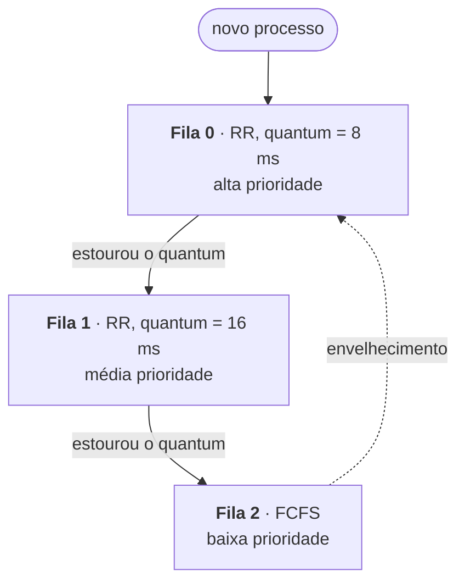

# Unidade 6 · Scheduling da CPU

<div class="resumo-aula" markdown>
[:material-presentation-play: Abrir os slides](../arquivos/unidade-6.pdf){ .md-button .md-button--primary target="_blank" }
[:material-download: Baixar PDF · 59 slides](../arquivos/unidade-6.pdf){ .md-button download }
</div>

!!! abstract "Nesta unidade"
    1. **Escalonador da CPU** — ciclos de CPU e I/O, preempção e despachante
    2. **Critérios de escalonamento** — throughput, turnaround, espera e resposta
    3. **Algoritmos de escalonamento** — FCFS, SJF, prioridades, Round-Robin e filas multiníveis

## Slides

<div class="pdf-slides">
  <iframe src="../../arquivos/unidade-6.pdf#view=FitH" title="Slides da Unidade 6" loading="lazy"></iframe>
</div>

!!! tip "No celular os slides não aparecem?"
    Alguns navegadores de celular não exibem PDF dentro da página. Use o botão **Abrir os slides** acima.

## Resumo da unidade

### Parte I · Conceitos sobre scheduling da CPU

<span class="slides-ref">[Slides 3–15](../arquivos/unidade-6.pdf#page=3){ target="_blank" }</span>

O scheduling é a base dos sistemas **multiprogramados**: vários processos ficam na memória e, quando um precisa esperar (por I/O, por exemplo), o S.O entrega a CPU a outro, evitando que ela fique ociosa.

**Ciclos de picos de CPU e I/O.** Um processo alterna **picos de CPU** (processamento) e **picos de I/O** (espera). Começa com um pico de CPU, e o último pico de CPU encerra o processo.

**Scheduler da CPU** (ou de curto prazo): sempre que a CPU fica ociosa, escolhe um processo da **fila de prontos**. Essa fila **não é necessariamente FIFO**: pode ser uma fila, uma lista encadeada ou uma árvore/heap (ex.: árvore rubro-negra no Linux).

| | Sem preempção (cooperativo) | Com preempção |
|---|---|---|
| Quando a CPU é liberada | Só quando o processo **termina** ou **passa para espera** (I/O, `wait()`) | O S.O pode **retirar** o processo a qualquer momento (ex.: o *timer* expira) |
| Vantagem | Simples | Impede que um processo monopolize a CPU |
| Cuidado | — | Pode causar **condições de corrida** em dados compartilhados; o kernel precisa proteger suas seções críticas |

**Despachante (*dispatcher*).** Módulo que entrega a CPU ao processo escolhido: faz a **mudança de contexto**, passa para o **modo usuário** e **salta** para a instrução certa do programa.

### Parte II · Critérios de scheduling

<span class="slides-ref">[Slides 16–22](../arquivos/unidade-6.pdf#page=16){ target="_blank" }</span>

| Critério | O que mede | Meta |
|---|---|---|
| **Utilização da CPU** | Quanto tempo a CPU fica ocupada | Maximizar |
| **Throughput** | Processos concluídos por unidade de tempo (ex.: 1 processo/hora ou 10 processos/segundo) | Maximizar |
| **Tempo de turnaround** | Da submissão até a conclusão: espera por memória + fila de prontos + CPU + I/O | Minimizar |
| **Tempo de espera** | Soma dos períodos na **fila de prontos** — é o único tempo que o algoritmo afeta | Minimizar |
| **Tempo de resposta** | Da submissão até a **primeira resposta** — essencial em sistemas interativos | Minimizar |

Em geral otimiza-se a **média**; em alguns casos é melhor limitar os **extremos** (ex.: minimizar o tempo de resposta **máximo**, para ninguém esperar demais).

### Parte III · Algoritmos de scheduling

<span class="slides-ref">[Slides 23–58](../arquivos/unidade-6.pdf#page=23){ target="_blank" }</span>

#### FCFS — primeiro a chegar, primeiro a ser atendido

O mais simples: uma **fila FIFO**, **sem preempção**.

Processos chegando no tempo 0 com picos P1 = 24 ms, P2 = 3 ms, P3 = 3 ms:

=== "Ordem P1, P2, P3"

    ```text
    | P1                      | P2 | P3 |
    0                         24   27   30
    ```

    Espera: P1 = 0, P2 = 24, P3 = 27 → **média = (0 + 24 + 27) / 3 = 17 ms**

=== "Ordem P2, P3, P1"

    ```text
    | P2 | P3 | P1                      |
    0    3    6                         30
    ```

    Espera: P2 = 0, P3 = 3, P1 = 6 → **média = (0 + 3 + 6) / 3 = 3 ms**

!!! warning "Efeito comboio"
    No FCFS, processos curtos ficam presos atrás de um processo longo. O tempo médio de espera **não é ótimo** e varia muito com a ordem de chegada; o algoritmo é inadequado para sistemas interativos.

#### SJF — menor job primeiro

Associa a cada processo a duração do seu **próximo pico de CPU** e escolhe o **menor**; empates são resolvidos por FCFS. O SJF é **comprovadamente ótimo** para o tempo médio de espera. A dificuldade é **saber a duração do próximo pico** antes de executar.

=== "Exemplo sem chegadas"

    Picos: P1 = 6, P2 = 8, P3 = 7, P4 = 3 (ms).

    ```text
    | P4 | P1     | P3      | P2       |
    0    3        9         16         24
    ```

    Espera: P4 = 0, P1 = 3, P3 = 9, P2 = 16 → **média = 7 ms** (no FCFS seria 10,25 ms).

=== "Com chegadas e preempção"

    | Processo | Chegada | Pico |
    |---|---|---|
    | P1 | 0 | 8 |
    | P2 | 1 | 4 |
    | P3 | 2 | 9 |
    | P4 | 3 | 5 |

    Com preempção, um processo que chega com pico **menor que o tempo restante** do atual toma a CPU:

    ```text
    | P1 | P2   | P4    | P1      | P3        |
    0    1      5       10        17          26
    ```

    Espera: P1 = 10 − 1 = 9, P2 = 0, P3 = 17 − 2 = 15, P4 = 5 − 3 = 2 → **média = 26 / 4 = 6,5 ms**

    Sem preempção, P1 executaria até 8, e depois P2, P4 e P3: **média = (0 + 7 + 15 + 9) / 4 = 7,75 ms**.

#### Escalonamento por prioridades

Cada processo tem uma **prioridade**, e a CPU vai para a mais alta (empates em FCFS). O **SJF é um caso especial**, em que a prioridade é o inverso do próximo pico.

=== "Exemplo (menor número = maior prioridade)"

    | Processo | Pico | Prioridade |
    |---|---|---|
    | P1 | 10 | 3 |
    | P2 | 1 | 1 |
    | P3 | 2 | 4 |
    | P4 | 1 | 5 |
    | P5 | 5 | 2 |

    ```text
    | P2 | P5    | P1         | P3 | P4 |
    0    1       6            16   18   19
    ```

    Espera: P2 = 0, P5 = 1, P1 = 6, P3 = 16, P4 = 18 → **média = 41 / 5 = 8,2 ms**

=== "De onde vêm as prioridades"

    - **Internas:** medidas do próprio processo — limites de tempo, memória, arquivos abertos, razão entre I/O e CPU.
    - **Externas:** critérios fora do S.O — importância do processo, valor pago, departamento, políticas de uso.

Pode ser **com preempção** (o mais prioritário toma a CPU) ou **sem** (ele vai para a cabeça da fila).

!!! warning "Inanição e envelhecimento"
    Em sistemas carregados, processos de baixa prioridade podem **nunca** executar — no MIT, em 1973, acharam no IBM 7094 um processo submetido em 1967 que nunca havia rodado. A solução é o **envelhecimento** (*aging*): aumentar gradualmente a prioridade de quem espera muito (ex.: +1 a cada 15 minutos, numa escala de 127 a 0).

#### Round-Robin (RR)

Projetado para **tempo compartilhado**: é um FCFS **com preempção**. Cada processo usa a CPU por no máximo **um quantum** (tipicamente 10 a 100 ms) por vez.

- Se o pico é **menor** que o quantum, o processo libera a CPU sozinho.
- Se é **maior**, o *timer* interrompe, há troca de contexto e o processo vai para o **fim da fila**.

Exemplo com quantum = 4 ms e P1 = 24, P2 = 3, P3 = 3:

```text
| P1 | P2 | P3 | P1 | P1 | P1 | P1 | P1 |
0    4    7    10   14   18   22   26   30
```

Espera: P1 = 10 − 4 = 6, P2 = 4, P3 = 7 → **média = 17 / 3 ≈ 5,66 ms**

| Quantum | Efeito |
|---|---|
| **Muito longo** | Vira FCFS; processos curtos esperam os longos |
| **Equilibrado** | Boa interatividade, divisão justa, overhead sob controle |
| **Muito curto** | Trocas de contexto demais; desperdício de CPU |

#### Filas multiníveis

A fila de prontos é dividida em **várias filas**, cada uma com seu algoritmo (ex.: *foreground* interativo com RR e *background* batch com FCFS). Cada processo fica **permanentemente** em uma fila.

O escalonamento **entre as filas** pode ser:

- por **prioridade fixa** — ex.: sistema > interativos > edição interativa > batch > estudantes; filas inferiores só executam se as superiores estiverem vazias (risco de **inanição**);
- por **fatias de tempo** — ex.: 80% da CPU para o foreground e 20% para o background.

A vantagem é o **baixo overhead**; a desvantagem, a **inflexibilidade**.

#### Filas multiníveis com retroalimentação

Os processos **mudam de fila** conforme o comportamento:

- quem **estoura o quantum** (usa muita CPU) é **rebaixado**;
- quem **espera demais** em uma fila inferior é **promovido** (envelhecimento), evitando inanição.



Ele é definido por **cinco parâmetros**: número de filas, algoritmo de cada fila, critério de promoção, critério de rebaixamento e fila de entrada. É o algoritmo **mais geral e flexível**, e também o **mais complexo** de configurar.
